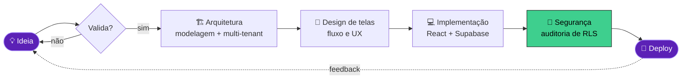

<!-- ═══════════════════════════════  HEADER  ═══════════════════════════════ -->
<div align="center">


<a href="https://git.io/typing-svg">
  
</a>

<br/>


<a href="https://www.linkedin.com/in/SEU_LINKEDIN"></a>
<a href="mailto:SEU_EMAIL"></a>
<a href="https://github.com/JoaoGabrielMSantos?tab=repositories"></a>


</div>

<br/>

<!-- ═══════════════════════════════  TERMINAL (NEOFETCH)  ═══════════════════════════════ -->
<!-- Quando tiver a foto em ASCII, substitua as letras "JG" à esquerda por ela -->
```text
                      gabriel@github
                      ──────────────────────────────────────
                      OS........: Linux 🐧
     ██╗ ██████╗      Host......: Universidade Católica de Brasília
     ██║██╔════╝      Curso.....: Ciência da Computação (2027)
     ██║██║  ███╗     Trabalho..: Estagiário @ Ministério da Defesa
██   ██║██║   ██║     Shell.....: TypeScript
╚█████╔╝╚██████╔╝     Frontend..: React · TypeScript
 ╚════╝  ╚═════╝      Backend...: Node.js · Java · Python
                      Database..: PostgreSQL · Supabase (RLS)
                      Automação.: n8n
                      IDE.......: VS Code + Claude Code
                      Contato...: linkedin.com/in/SEU_LINKEDIN
```

<!-- ═══════════════════════════════  SOBRE MIM  ═══════════════════════════════ -->
##  Sobre mim

<table>
<tr>
<td width="58%" valign="top">

```typescript
const gabriel: Developer = {
  nome:       "João Gabriel",
  local:      "Brasília, Brasil 🇧🇷",
  formacao: {
    curso:     "Ciência da Computação",
    faculdade: "Universidade Católica de Brasília",
    conclusao: 2027,
  },
  atualmente: [
    "Estagiário no Ministério da Defesa",
    "Construindo SaaS multi-tenant",
    "Automatizando tudo com n8n",
  ],
  foco:       ["Fullstack", "Arquitetura", "Produto"],
  filosofia:  "Código bom resolve problema de gente de verdade.",
};
```

</td>
<td width="42%" valign="top">

- 🏛️ Estagiário no **Ministério da Defesa**
- 🎓 Ciência da Computação na **UCB**, formatura em **2027**
- 🏭 Ex-residente **Porto Digital**, com um sistema para a indústria têxtil integrado ao ERP Bling
- 🧱 Curto **multi-tenant**, **RLS** e **Repository Pattern**
- ⚡ Automatizo processos com **n8n** + **Python**
- 💬 Pode falar comigo sobre **SaaS, Supabase, automação e produto**

</td>
</tr>
</table>

<br/>

<!-- ═══════════════════════════════  EXPERIÊNCIA  ═══════════════════════════════ -->
## 💼 Experiência

<table>
<tr>
<td width="90" align="center" valign="top"><h1>🏛️</h1></td>
<td valign="top">

### Ministério da Defesa
**Estagiário** · Governo Federal · Brasília/DF  


<!-- ✏️ Troque os itens abaixo pelas suas atividades reais quando tiver mais clareza delas -->
- Estágio na administração pública federal
- Apoio à equipe com tratamento e organização de dados
- Contato com processos, rotinas e escala de um órgão do Governo Federal

</td>
</tr>

<tr>
<td width="90" align="center" valign="top"><h1>🏭</h1></td>
<td valign="top">

### Residência em Software — Porto Digital
**Desenvolvedor Fullstack (residente)** · em parceria com a UCB  


- Desenvolvi o **Fabryka**, sistema de gestão para uma indústria de malharia integrado ao **ERP Bling**
- Geração automática de **fichas técnicas** com custo e preço para atingir a margem de lucro-alvo
- Fiz uma **auditoria de segurança (RLS)** que fechou o acesso não autenticado a todas as 8 tabelas do banco
- Projeto eleito entre os **melhores do semestre**

</td>
</tr>
</table>

<br/>

<!-- ═══════════════════════════════  STACK  ═══════════════════════════════ -->
## 🛠️ Stack & ferramentas

<div align="center">

### Frontend


### Backend


### Banco de dados & BaaS


### DevOps & ferramentas


<br/>


</div>

<br/>

<!-- ═══════════════════════════════  PROJETOS  ═══════════════════════════════ -->
## 🚀 Projetos em destaque

<table>
<tr>
<th width="25%">Projeto</th>
<th width="50%">O que resolve</th>
<th width="25%">Stack</th>
</tr>

<tr>
<td>🏫 <b><a href="https://github.com/JoaoGabrielMSantos/prototipo_gestao_escolar">Gestão Escolar SaaS</a></b><br/><br/>


</td>
<td>Plataforma <b>multi-tenant</b> para escolas com perfis de <b>Secretaria, Professor, Aluno e Responsável</b> (que alterna entre vários dependentes). Notas, turmas, comunicados por turma e um módulo de <b>Atividades</b> no estilo Google Classroom.</td>
<td><code>React</code> <code>TS</code> <code>Supabase</code> <code>RLS</code> <code>Edge Functions</code></td>
</tr>

<tr>
<td>🏭 <b>Fabryka</b><br/><br/>

</td>
<td>Sistema de gestão para indústria de malharia, integrado ao <b>ERP Bling</b>. Gera <b>fichas técnicas</b> com custo do produto e o preço necessário para atingir a margem de lucro-alvo. Eleito entre os melhores projetos do semestre.</td>
<td><code>React</code> <code>TS</code> <code>Supabase</code> <code>Bling API</code></td>
</tr>

<tr>
<td>💸 <b>Racha Aí</b><br/><br/>

</td>
<td>Divide despesas de grupo e calcula quem deve pra quem, com acerto de contas via <b>QR Code Pix</b>.</td>
<td><code>React</code> <code>TS</code> <code>Supabase</code> <code>Pix</code></td>
</tr>

<tr>
<td>⚙️ <b><a href="https://github.com/JoaoGabrielMSantos/pre-processador-assembler">Pré-processador Assembler</a></b><br/><br/>


</td>
<td>Pré-processador e <b>analisador léxico</b> em C para um subconjunto do assembly <b>MIPS</b>, feito para a disciplina de Linguagens Formais, Autômatos e Compiladores.</td>
<td><code>C</code> <code>Compiladores</code> <code>MIPS</code></td>
</tr>
</table>

<br/>

<!-- ═══════════════════════════════  COMO EU CONSTRUO  ═══════════════════════════════ -->
## 🧭 Como eu construo um produto



<details>
<summary><b>🔐 Por que eu levo RLS a sério (clique para abrir)</b></summary>
<br/>

Durante a residência, uma auditoria encontrou políticas que permitiam **acesso não autenticado às oito tabelas** do banco. Reescrevi todas com uma guarda explícita:

```sql
-- antes: qualquer um, até sem login, lia tudo 😬
create policy "leitura" on produtos for select using (true);

-- depois: só usuários autenticados
create policy "leitura" on produtos for select
  using ( auth.role() = 'authenticated' );
```

Desde então, todo projeto meu passa por uma revisão de RLS antes do deploy.
</details>

<details>
<summary><b>🧱 Padrões que eu uso no dia a dia</b></summary>
<br/>

| Padrão | Pra quê |
|---|---|
| **Repository Pattern** | Isola o acesso a dados da regra de negócio, então trocar o Supabase por outra coisa não quebra o app |
| **Multi-tenant com RLS** | Cada cliente vê só os próprios dados, com a garantia no banco e não só no front |
| **Edge Functions** | Lógica sensível (integrações, webhooks, pagamentos) fora do cliente |
| **Automação com n8n** | Tarefas repetitivas viram fluxos que rodam sozinhos |

</details>

<br/>

<!-- ═══════════════════════════════  ESTATÍSTICAS  ═══════════════════════════════ -->
<!-- Os SVGs da pasta metrics/ são gerados pelo workflow .github/workflows/metrics.yml -->
## 📊 Estatísticas

<div align="center">


</div>

<br/>

<!-- ═══════════════════════════════  COBRINHA  ═══════════════════════════════ -->
## 🐍 Comendo minhas contribuições

<div align="center">
<picture>
  <source media="(prefers-color-scheme: dark)" srcset="https://raw.githubusercontent.com/JoaoGabrielMSantos/JoaoGabrielMSantos/output/github-contribution-grid-snake-dark.svg"/>
  <source media="(prefers-color-scheme: light)" srcset="https://raw.githubusercontent.com/JoaoGabrielMSantos/JoaoGabrielMSantos/output/github-contribution-grid-snake.svg"/>
  
</picture>
</div>

<br/>

<!-- ═══════════════════════════════  FOOTER  ═══════════════════════════════ -->
<div align="center">

### 🤝 Bora construir algo junto?

Aberto a **projetos freelance**, **parcerias** e **trocas de ideia** sobre produto e SaaS.

<a href="https://www.linkedin.com/in/SEU_LINKEDIN"></a>

<br/><br/>


</div>
